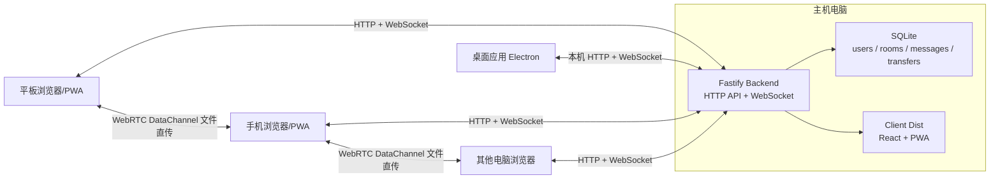
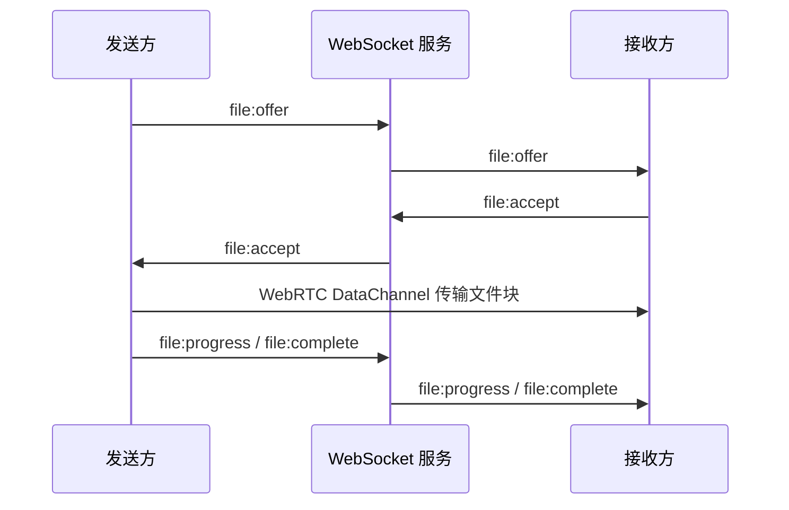
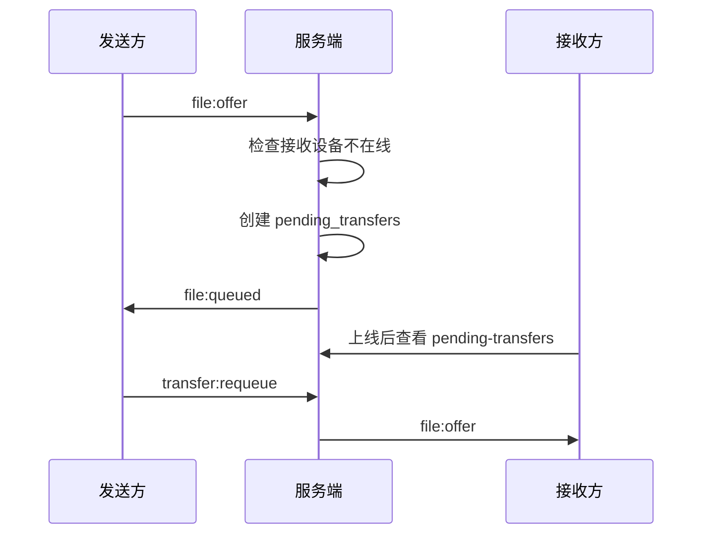

# Flow Socket

Flow Socket 是一个“局域网优先、可手动扩展到异网”的多设备内容流转系统。它解决的核心问题是：在手机、平板、笔记本、台式机之间临时传文字、链接、图片、PDF、文档和压缩包时，不再依赖微信/QQ/邮箱反复转发，而是让一台电脑作为主机，其他设备通过浏览器、PWA 或桌面应用接入同一个实时协作空间。

项目的核心实时通信基于 WebSocket，文件传输增强使用 WebRTC DataChannel。系统支持账号注册登录、设备管理、房间协作、邀请码/二维码入房、文本和链接实时同步、文件直传、离线挂起任务、消息置顶收藏、房间系统消息、手动服务器地址配置等功能。

## 目录

- [项目定位](#项目定位)
- [核心特性](#核心特性)
- [技术栈](#技术栈)
- [系统架构](#系统架构)
- [业务模块](#业务模块)
- [目录结构](#目录结构)
- [环境要求](#环境要求)
- [快速开始](#快速开始)
- [局域网使用方式](#局域网使用方式)
- [桌面应用打包](#桌面应用打包)
- [配置说明](#配置说明)
- [HTTP API](#http-api)
- [WebSocket 事件](#websocket-事件)
- [数据库设计](#数据库设计)
- [文件传输流程](#文件传输流程)
- [测试与验收](#测试与验收)
- [常见问题](#常见问题)
- [安全与边界](#安全与边界)
- [后续优化方向](#后续优化方向)

## 项目定位

Flow Socket 的首版部署模型是“固定一台电脑常开”：

- 主机电脑运行后端服务和前端静态资源。
- 同一局域网内的手机、平板、其他电脑通过 `http://主机IP:端口` 访问。
- 如果使用手机热点，只要主机和其他设备连到同一个热点，也按同样方式访问。
- 如果后续需要跨网络使用，可以在设置里手动填写公网服务器或内网穿透地址。

这个设计适合课程项目、宿舍/办公室局域网工具、个人多设备资料流转、小团队临时协作等场景。

## 核心特性

- 账号注册、登录、退出。
- 每个登录端都会记录为一个设备。
- 支持设备列表查看和当前设备重命名。
- 创建房间。
- 通过邀请码加入房间。
- 通过邀请链接加入房间。
- 通过二维码扫码入房。
- 离开房间。
- 房间在线状态同步。
- 房间内文本消息实时同步。
- 房间内链接消息实时同步。
- 房间内系统消息，例如创建房间、加入房间、离开房间、删除挂起任务。
- 消息搜索。
- 消息置顶。
- 消息收藏。
- 在线文件直传。
- 接收方离线时创建挂起任务。
- 挂起任务重新发起。
- 删除挂起任务。
- PWA 静态资源缓存。
- 手动切换服务器地址。
- 局域网发现提示。
- 服务状态接口。
- macOS 桌面应用打包。
- Windows 桌面应用打包。

## 技术栈

前端：

- React 19
- TypeScript
- Vite
- Vite PWA
- IndexedDB 本地缓存
- QRCode 二维码生成

后端：

- Node.js
- Fastify
- `@fastify/websocket`
- SQLite (`node:sqlite`)
- JWT
- bcryptjs
- nanoid

实时通信：

- WebSocket：登录后长连接、房间事件、在线状态、文本/链接消息、文件传输协商、文件进度事件。
- WebRTC DataChannel：在线设备之间点对点文件直传。

桌面端：

- Electron
- Electron Builder

## 系统架构



系统中的 WebSocket 是核心 socket 通道，负责所有实时业务事件。WebRTC 只负责文件数据流传输，文件协商、进度和状态仍然通过 WebSocket 完成。

## 业务模块

### 认证模块

用户可以注册、登录和退出。登录成功后，服务端会签发 JWT，客户端用这个 token 访问 HTTP API 和建立 WebSocket 长连接。

注册字段：

- username
- password
- displayName
- deviceName

登录字段：

- username
- password
- deviceName

### 设备模块

同一个账号可以在多台设备登录。每台设备都会生成独立设备 ID，用于在线状态判断、WebSocket 连接绑定和文件传输目标选择。

设备能力：

- 查看当前用户设备列表。
- 重命名当前设备。
- 判断设备是否在线。
- 文件发送时可以选择具体接收设备。

### 房间模块

系统以房间为核心，不做好友关系系统。用户可以创建多个房间，每个房间有邀请码。

房间能力：

- 创建房间。
- 加入房间。
- 通过邀请链接加入。
- 通过二维码加入。
- 离开房间。
- 查看房间成员和成员设备。
- 同步房间在线状态。

### 消息模块

房间内支持文本和链接消息。消息会保存到 SQLite，重新打开页面后可以加载历史记录。

消息能力：

- 文本消息实时推送。
- 链接消息实时推送。
- 系统消息实时推送。
- 消息搜索。
- 消息置顶。
- 消息收藏。

### 文件传输模块

文件不长期保存到服务器。服务器只保存文件传输记录和挂起任务。

在线时：

- 发送方通过 WebSocket 发起 `file:offer`。
- 接收方通过 WebSocket 接收请求。
- 接收方接受后，双方通过 WebRTC DataChannel 传输文件。
- 进度和完成状态通过 WebSocket 同步。

离线时：

- 接收方设备不在线时，服务端创建挂起任务。
- 接收方上线后，发送方可以重新发起传输。
- 用户也可以删除挂起任务。

首版文件大小目标：

- 1GB 以内。
- 超过 1GB 的文件会被客户端和服务端拦截。

### 局域网发现与手动服务器模块

系统提供 `/api/system/discovery-hint` 和 `/api/system/status` 用于展示主机地址和服务状态。前端设置页支持手动填写服务器地址，方便后续接入公网服务器或内网穿透地址。

## 目录结构

```text
.
├── client                  # React + Vite PWA 前端
│   ├── public              # favicon / icons
│   └── src
│       ├── App.tsx         # 主应用逻辑
│       ├── App.css         # 主样式
│       ├── types.ts        # 前端类型
│       └── lib/cache.ts    # IndexedDB 缓存
├── server                  # Fastify 后端
│   └── src
│       ├── index.ts        # HTTP API + WebSocket
│       ├── db.ts           # SQLite 表结构和数据访问
│       ├── auth.ts         # 密码和 JWT
│       ├── env.ts          # .env 加载
│       └── types.ts        # 后端共享类型
├── desktop                 # Electron 桌面壳
│   ├── main.cjs            # Electron 主进程
│   └── package.json        # 桌面打包配置
├── scripts
│   └── smoke-test.mjs      # 端到端冒烟测试
├── .env.example            # 环境变量示例
├── package.json            # 根目录脚本
├── pnpm-workspace.yaml     # pnpm workspace
└── README.md
```

## 环境要求

源码开发需要：

- Node.js 25+
- pnpm 10+
- Git

说明：后端使用 `node:sqlite`，因此建议使用 Node.js 25+。桌面打包后的 Windows/macOS 应用内置 Electron 运行时，不要求目标电脑安装 Node.js。

## 快速开始

安装依赖：

```bash
pnpm install
```

复制配置文件：

```bash
cp .env.example .env
```

开发模式启动：

```bash
pnpm dev
```

开发模式地址：

- 前端：`http://127.0.0.1:5173`
- 后端：`http://127.0.0.1:8787`

生产构建：

```bash
pnpm build
```

生产模式启动：

```bash
pnpm start
```

生产模式下由后端统一托管前端页面。打开：

```text
http://127.0.0.1:8787
```

## 局域网使用方式

主机电脑启动服务后，会监听 `0.0.0.0`。同一局域网内的设备访问：

```text
http://主机局域网IP:8787
```

例如：

```text
http://192.168.2.180:8787
```

查看本机局域网 IP：

macOS/Linux：

```bash
ifconfig
```

Windows：

```cmd
ipconfig
```

如果使用手机热点：

1. 主机电脑连接手机热点。
2. 其他设备也连接同一个热点。
3. 其他设备访问主机电脑在热点网络下的 IP。

如果其他设备无法访问：

- 确认所有设备在同一个 Wi-Fi 或热点下。
- 不要在其他设备上访问 `127.0.0.1`，这个地址只代表设备自己。
- 检查主机防火墙是否允许 Node.js 或 Flow Socket 接收局域网连接。
- 检查端口是否为 `8787`，如果改过 `PORT`，要访问对应端口。

服务状态接口：

```text
http://主机局域网IP:8787/api/system/status
```

## 桌面应用打包

### macOS

```bash
pnpm desktop:pack:mac
```

产物默认在：

```text
desktop/dist/
```

### Windows

```bash
pnpm desktop:pack:win
```

产物默认在：

```text
desktop/dist/
```

Windows 打包产物是免安装 zip，解压后运行：

```text
Flow Socket.exe
```

### 桌面应用工作方式

桌面应用启动后会：

1. 自动启动内置 Fastify 后端。
2. 自动选择端口，默认优先使用 `8787`。
3. 打开 Electron 窗口访问本机服务。
4. 将 SQLite 数据保存到 Electron 用户数据目录。

macOS 数据目录示例：

```text
~/Library/Application Support/flow-socket-desktop/data/app.sqlite
```

Windows 数据目录通常类似：

```text
C:\Users\用户名\AppData\Roaming\flow-socket-desktop\data\app.sqlite
```

## 配置说明

`.env.example`：

```env
PORT=8787
JWT_SECRET=replace-with-a-long-random-secret
MAX_MESSAGE_LENGTH=4000
MAX_FILE_SIZE_BYTES=1073741824
```

配置项说明：

- `PORT`：后端监听端口，默认 `8787`。
- `JWT_SECRET`：JWT 签名密钥，正式使用时必须改成随机长字符串。
- `MAX_MESSAGE_LENGTH`：单条消息最大字符数。
- `MAX_FILE_SIZE_BYTES`：允许传输的最大文件大小，默认 1GB。
- `FLOW_SOCKET_DATA_DIR`：可选，指定 SQLite 数据库父目录。
- `CLIENT_DIST_DIR`：可选，指定前端构建产物目录，桌面应用内部会使用。
- `HOST`：可选，后端监听主机地址。

## HTTP API

### 认证

注册：

```http
POST /api/auth/register
```

请求体：

```json
{
  "username": "alice",
  "password": "password123",
  "displayName": "Alice",
  "deviceName": "Alice Phone"
}
```

登录：

```http
POST /api/auth/login
```

请求体：

```json
{
  "username": "alice",
  "password": "password123",
  "deviceName": "Alice Phone"
}
```

当前用户：

```http
GET /api/me
Authorization: Bearer <token>
```

### 设备

重命名当前设备：

```http
PATCH /api/devices/current
Authorization: Bearer <token>
```

请求体：

```json
{
  "name": "MacBook Pro"
}
```

### 房间

创建房间：

```http
POST /api/rooms
Authorization: Bearer <token>
```

请求体：

```json
{
  "name": "我的设备流转房间"
}
```

加入房间：

```http
POST /api/rooms/join
Authorization: Bearer <token>
```

请求体：

```json
{
  "inviteCode": "ABCD1234"
}
```

离开房间：

```http
POST /api/rooms/:roomId/leave
Authorization: Bearer <token>
```

房间消息：

```http
GET /api/rooms/:id/messages
Authorization: Bearer <token>
```

房间挂起任务：

```http
GET /api/rooms/:id/pending-transfers
Authorization: Bearer <token>
```

### 消息

更新置顶/收藏：

```http
PATCH /api/messages/:messageId/flags
Authorization: Bearer <token>
```

请求体：

```json
{
  "pinned": true,
  "favorited": true
}
```

### 文件挂起任务

删除挂起任务：

```http
DELETE /api/pending-transfers/:pendingTransferId
Authorization: Bearer <token>
```

### 系统

发现提示：

```http
GET /api/system/discovery-hint
```

服务状态：

```http
GET /api/system/status
```

手动保存服务器入口：

```http
PATCH /api/settings/server-endpoint
Authorization: Bearer <token>
```

请求体：

```json
{
  "serverEndpoint": "http://192.168.2.180:8787"
}
```

## WebSocket 事件

连接地址：

```text
ws://主机IP:8787/ws?token=<JWT>
```

通用消息格式：

```json
{
  "type": "message:text",
  "payload": {}
}
```

主要事件：

- `auth:ready`：WebSocket 登录成功后返回初始数据。
- `presence:update`：房间在线状态更新。
- `room:joined`：用户加入房间。
- `room:left`：用户离开房间。
- `message:text`：文本消息。
- `message:link`：链接消息。
- `message:system`：系统消息。
- `message:flags`：消息置顶/收藏状态更新。
- `file:offer`：发起文件传输请求。
- `file:accept`：接收方接受文件。
- `file:reject`：接收方拒绝文件。
- `file:signal`：WebRTC 信令交换。
- `file:progress`：文件传输进度。
- `file:complete`：文件传输完成。
- `file:failed`：文件传输失败。
- `file:queued`：接收方离线，文件进入挂起状态。
- `pending-transfer:deleted`：挂起任务被删除。
- `transfer:requeue`：重新发起挂起任务。
- `app:error`：服务端主动返回业务错误。

## 数据库设计

当前使用 SQLite。默认数据文件：

```text
server/data/app.sqlite
```

主要表：

- `users`：用户账号。
- `devices`：用户设备。
- `rooms`：房间。
- `room_members`：房间成员关系。
- `messages`：文本、链接和系统消息。
- `message_flags`：用户对消息的置顶和收藏状态。
- `file_transfers`：文件传输记录。
- `pending_transfers`：离线挂起任务。
- `app_settings`：应用级设置，例如服务器入口。

清空开发数据：

```bash
rm -f server/data/app.sqlite
```

重新启动后会自动建表。

## 文件传输流程

在线直传：



离线挂起：



## 测试与验收

代码检查和构建：

```bash
pnpm verify
```

冒烟测试：

```bash
pnpm smoke
```

冒烟测试会自动启动一个临时服务和临时数据库，不污染正式数据。

测试已有服务：

```bash
BASE_URL=http://127.0.0.1:8787 pnpm smoke
```

冒烟测试覆盖：

- 注册用户。
- 创建房间。
- 加入房间。
- WebSocket 文本消息。
- 系统消息。
- 置顶和收藏。
- 离线文件挂起。
- 删除挂起任务。
- 离开房间。
- 服务状态接口。

人工验收建议：

- 同一 Wi-Fi 下手机可以打开主机地址。
- 手机和电脑分别注册登录。
- 一个设备创建房间，另一个设备扫码加入。
- 文本和链接可以实时同步。
- 在线设备之间可以传图片、PDF、文档和压缩包。
- 接收方离线时可以生成挂起任务。
- 接收方上线后可以重新发起挂起任务。
- 消息可以置顶和收藏。
- 离开房间后另一个成员能看到系统消息。
- 主机 IP 改变时，前端不会卡死，可以手动切换服务器入口。

## 常见问题

### 为什么其他设备不能访问？

通常是网络或防火墙问题：

- 确认设备在同一局域网。
- 确认访问的是主机局域网 IP，不是 `127.0.0.1`。
- 检查主机防火墙是否允许端口 `8787`。
- 检查主机是否真的启动成功。

### 为什么桌面应用打开后别人访问不了？

桌面应用当前默认优先服务本机窗口。如果要作为局域网主机，建议使用源码版或便携版启动方式，确保服务监听 `0.0.0.0` 并允许防火墙访问。

### 为什么不把文件保存到服务器？

首版目标是多设备即时流转，不是网盘。文件默认走 WebRTC 点对点直传，服务器只保存传输记录和挂起状态。这样可以减少服务器磁盘压力，也更符合局域网工具定位。

### 不同网络下能不能用？

可以预留接入，但需要一个可访问的服务器地址。例如：

- 公网服务器。
- 内网穿透地址。
- Tailscale / ZeroTier 等虚拟组网地址。

前端设置里可以手动填写 `server base URL`。

### 文件最大能传多大？

首版工程目标是 1GB 以内。过大的文件会被客户端和服务端拦截。浏览器、内存和网络质量都会影响稳定性。

## 安全与边界

当前版本适合可信局域网或个人使用。正式开放给更多用户前，建议继续增强：

- HTTPS。
- 更强的密码策略。
- 登录限流。
- 用户名和房间名敏感词过滤。
- 文件类型和文件名安全检查。
- 更细的房间权限。
- 管理员角色。
- 审计日志。
- 数据备份和恢复。
- PostgreSQL 替换 SQLite。
- 服务端文件中转或对象存储。

## 后续优化方向

- mDNS/Bonjour 自动发现。
- Windows/macOS 托盘图标。
- 桌面端一键显示局域网二维码。
- 房间成员权限管理。
- 消息删除和编辑。
- 文件传输断点续传。
- 文件夹批量传输。
- 剪贴板自动同步。
- 局域网广播发现。
- 公网部署模板。
- Docker 部署。
- PostgreSQL 适配。
- 移动端 PWA 优化。
- 更完善的端到端测试。

## 许可证

当前项目未指定开源许可证。如果要公开给他人复用，建议后续补充 MIT、Apache-2.0 或其他合适许可证。
